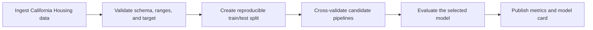
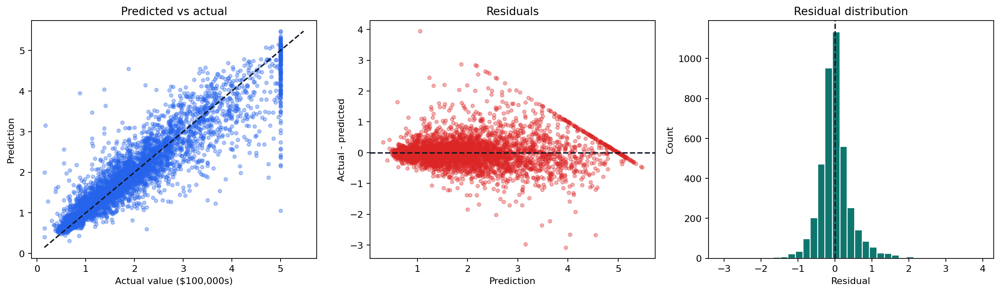
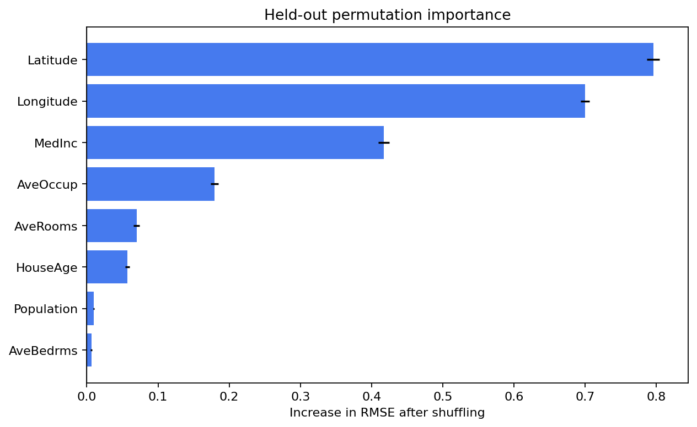
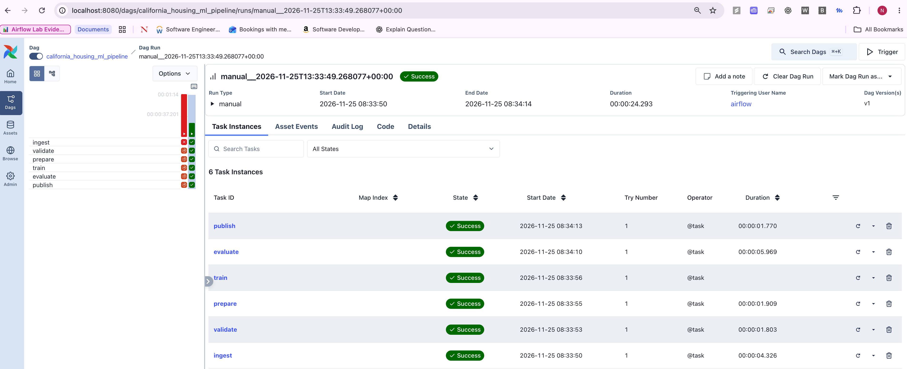
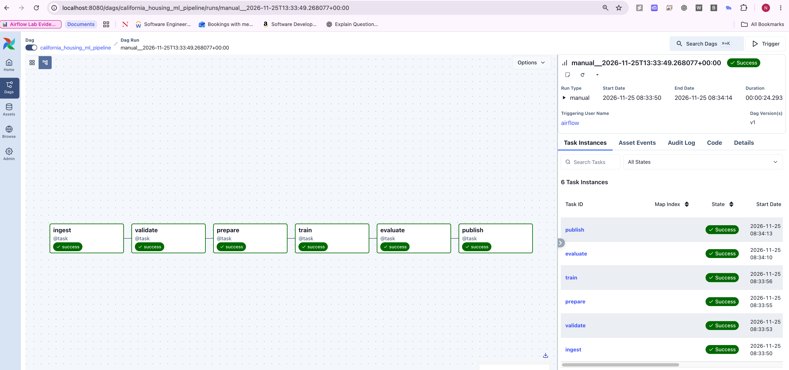

# California Housing ML Pipeline with Apache Airflow

This lab is based on the course's Airflow Lab 1, which orchestrates a credit-card
customer clustering workflow using K-Means. This version changes the problem to
California home-value regression and builds a testable, artifact-oriented ML
pipeline.

## Workflow



The tasks will exchange small JSON-safe metadata through XCom. Datasets, the
fitted model, plots, and reports will be written to a mounted artifact directory
instead of being serialized into Airflow's metadata database.

## Original lab and enhancements

### Original Airflow Lab 1

The starting point is the official
[Airflow Lab 1](https://github.com/raminmohammadi/MLOps/tree/main/Labs/Airflow_Labs/Lab_1)
from the course repository. It demonstrates how to turn four Python functions
into a sequential Airflow DAG.

#### Original machine-learning workflow

1. `load_data` reads a credit-card customer CSV and serializes the entire Pandas
   DataFrame for the next task.
2. `data_preprocessing` drops missing rows, selects `BALANCE`, `PURCHASES`, and
   `CREDIT_LIMIT`, and scales them with `MinMaxScaler`.
3. `build_save_model` fits K-Means for every value of `k` from 1 through 49,
   records the sum of squared errors, and saves a model as `model.sav`.
4. `load_model_elbow` loads the saved model, uses `KneeLocator` to print the
   elbow value, and predicts a cluster for a test CSV.

The current helper code makes the pickled DataFrame and NumPy array JSON-safe by
base64-encoding them before they are placed in XCom. The list of SSE values is
also returned through XCom.

#### Original Airflow workflow

The DAG uses four `PythonOperator` tasks in one linear dependency chain:

```text
load_data_task
    -> data_preprocessing_task
    -> build_save_model_task
    -> load_model_task
```

It defines an owner, start date, retry delay, zero retries, and `catchup=False`.
The repository also provides CSV inputs, an Airflow configuration, a setup
script, Docker-based setup instructions, and instructions for triggering and
observing the DAG in the Airflow UI.

### Enhancements in this project

This implementation replaces credit-card customer clustering with California
home-value regression and extends the workflow with data validation, model
comparison, held-out evaluation, reproducible artifacts, and automated tests.

1. **A different problem and dataset.** It predicts median California home
   values from 20,640 census-block groups instead of clustering credit-card
   customers. The ingestion task records the dataset source, row count, schema,
   and checksum.
2. **A real validation gate.** A dedicated task checks required columns, numeric
   types, finite values, nulls, duplicates, geographic bounds, non-negative
   housing attributes, and target validity. Training cannot start after a failed
   contract.
3. **Leakage-safe preparation.** The held-out test set is created before model
   selection. Preprocessing is placed inside each scikit-learn `Pipeline`, so
   scalers are fitted only on the corresponding training fold.
4. **Model comparison instead of one fixed algorithm.** Elastic Net, Random
   Forest, and Histogram Gradient Boosting are compared using training-only
   cross-validation. The candidate with the lowest mean validation RMSE is
   refitted and saved.
5. **Evaluation beyond a single prediction.** The selected model is measured on
   untouched test data using MAE, RMSE, and R-squared. The lab also creates
   residual diagnostics, permutation feature importance, and geographic slice
   metrics to reveal where errors are concentrated.
6. **Small, safe XCom messages.** XCom contains JSON metadata and artifact paths,
   not complete DataFrames, NumPy arrays, or fitted models. Larger objects are
   saved in a mounted artifact directory.
7. **Idempotent, run-scoped artifacts.** Each DAG run writes to a deterministic
   run directory using atomic file replacement. Retrying a task does not append
   duplicate data or silently mix artifacts from different runs.
8. **Explicit failure behavior.** Tasks validate their inputs and fail with
   useful error messages. Airflow retries transient task failures, while invalid
   data stops the pipeline immediately.
9. **Automated verification.** Unit tests cover ingestion, validation,
   preprocessing, selection, evaluation, and artifact reloading. DAG tests check
   imports, task IDs, dependencies, retry settings, and template rendering. An
   end-to-end test runs the ML functions outside the scheduler.
10. **Reproducible local operation.** Docker Compose pins the Airflow and Python
    dependencies, mounts DAG/source/artifact directories, initializes Airflow,
    and exposes the UI with documented commands and health checks.
11. **Reproducible evidence.** A successful run produces the selected
    model, validation report, candidate comparison, metrics JSON, predictions,
    plots, and an automatically generated model card.

### Side-by-side comparison

| Area | Original course lab | Enhanced implementation |
|---|---|---|
| Problem | Unsupervised customer clustering | California median home-value regression |
| Dataset | Credit-card CSV | California Housing dataset (20,640 census-block groups, 8 predictors) |
| Modeling | K-Means over a fixed range of clusters | Leakage-safe comparison of Elastic Net, random forest, and histogram gradient boosting |
| Selection | Elbow method | K-fold cross-validation using RMSE |
| Evaluation | Cluster prediction | Held-out MAE, RMSE, R-squared, residual diagnostics, regional slices, and feature importance |
| Task communication | Pickled data through XCom | JSON metadata through XCom; data and models stored as artifacts |
| Reliability | Demonstration DAG | Data contracts, deterministic splits, idempotent tasks, tests, retries, and failure handling |
| Outputs | Saved clustering model | Model, metrics, candidate comparison, residual plots, slice report, feature importance, and model card |
| Reproducibility | Manual Airflow setup and runtime instructions | Pinned dependencies, Docker Compose, deterministic seeds, run manifests, and checksums |
| Testing | No automated test suite | ML unit/integration tests plus Airflow DAG-structure tests |
| Preprocessing at inference | Test CSV sent directly to the fitted estimator | Saved scikit-learn pipeline applies the exact fitted preprocessing steps |

## Project structure

```text
Airflow_Lab1/
|-- dags/
|   `-- california_housing_pipeline.py
|-- src/
|   |-- common.py
|   |-- data.py
|   |-- training.py
|   |-- evaluation.py
|   |-- reporting.py
|   `-- run_pipeline.py
|-- tests/
|   |-- test_dag.py
|   |-- test_data.py
|   |-- test_training.py
|   `-- test_pipeline.py
|-- artifacts/
|-- assets/
|-- reports/
|-- Dockerfile
|-- docker-compose.yml
|-- requirements.txt
|-- requirements-dev.txt
|-- pytest.ini
`-- README.md
```

## Run the lab

Docker Desktop needs at least 4 GB of memory. The setup uses Airflow's
development-only standalone mode with the Simple Auth Manager; it is not a
production deployment.

### 1. Build and test

```bash
cd Airflow_Lab1
docker compose build
docker compose --profile test run --rm tests
```

The container test suite includes the Airflow DAG import and graph assertions.

### 2. Start Airflow

```bash
docker compose up -d airflow
docker compose ps
```

Open [http://localhost:8080](http://localhost:8080). Authentication is disabled
only for this local lab environment. The health check waits for Airflow's API
health endpoint.

### 3. Trigger and monitor the DAG

```bash
docker compose exec airflow airflow dags trigger california_housing_ml_pipeline
docker compose exec airflow airflow dags list-runs california_housing_ml_pipeline
```

The UI shows the dependency chain and task logs. Generated files appear under
`artifacts/<sanitized-run-id>/`. The first ingestion downloads the public data;
later runs reuse the cache under `artifacts/.cache/`.

### 4. Stop the environment

```bash
docker compose down
```

This preserves the Airflow database and artifacts. To deliberately delete the
local Airflow database as well, use `docker compose down --volumes`.

### Run the ML workflow without Airflow

This is useful for development and debugging:

```bash
python -m venv .venv
source .venv/bin/activate
python -m pip install -r requirements-dev.txt
python -m src.run_pipeline --run-id local_manual
python -m pytest -q
```

## Measured results

The reference run used all 20,640 rows, a deterministic 80/20 split, and five
shuffled training folds. It was executed on November 25, 2026. Histogram
Gradient Boosting was selected using cross-validation before the held-out test
set was evaluated.

| Candidate | CV RMSE | CV MAE | CV R-squared |
|---|---:|---:|---:|
| **Histogram Gradient Boosting** | **0.4590** | **0.3046** | **0.8419** |
| Random Forest | 0.5075 | 0.3323 | 0.8067 |
| Elastic Net | 0.7214 | 0.5287 | 0.6095 |

Held-out results on 4,128 rows:

| MAE | RMSE | R-squared | Mean residual |
|---:|---:|---:|---:|
| 0.3062 | 0.4642 | 0.8367 | 0.0039 |

The target and errors are in units of $100,000. An RMSE of 0.4642 therefore
corresponds to approximately $46,420, but census-block medians are not individual
home appraisals.



### Feature importance

Held-out permutation importance measures the increase in RMSE after shuffling a
feature ten times. Latitude (0.7957), longitude (0.6998), and median income
(0.4173) produced the largest mean increases. These values describe model
reliance, not causality.



### Geographic diagnostics

The held-out rows were divided into four approximately equal latitude bands.
The north-central band had the lowest RMSE (0.4310); the northmost band had the
highest (0.4895). These are error diagnostics, not demographic fairness groups.
Exact results are committed under `reports/` together with the generated model
card and data-validation report.

## Verification

- **Local suite:** 10 passed; the Airflow-only test is skipped when Airflow is
  not installed in the host environment.
- **Airflow container suite:** 11 passed, including DAG import, task IDs,
  dependency order, retry configuration, and end-to-end ML functions.
- **Airflow runtime:** the service became healthy, reported no DAG import
  errors, and discovered `california_housing_ml_pipeline`.
- **Real DAG run:** all six tasks succeeded under Airflow 3.1.8. The run took
  24.293 seconds from start to finish.
- **Idempotency:** rerunning the same run ID safely replaces its outputs, and
  the checksum manifest excludes itself so its hashes remain valid.

## Airflow run evidence

The successful Airflow run completed all six tasks in 24.293 seconds.



The graph view confirms the complete dependency chain and successful state of
every task.


