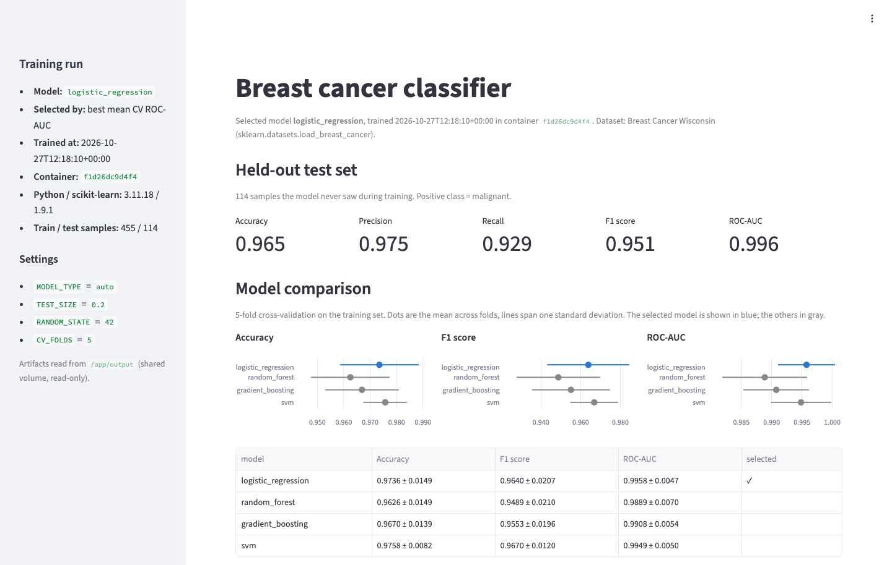
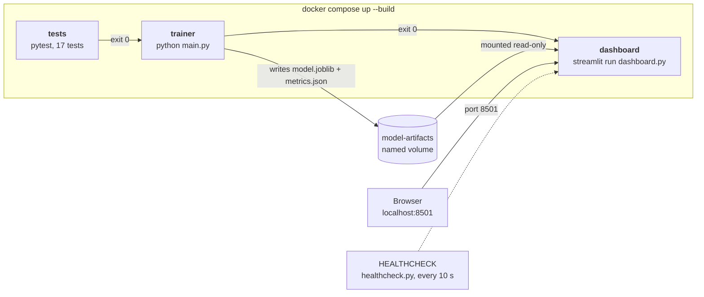
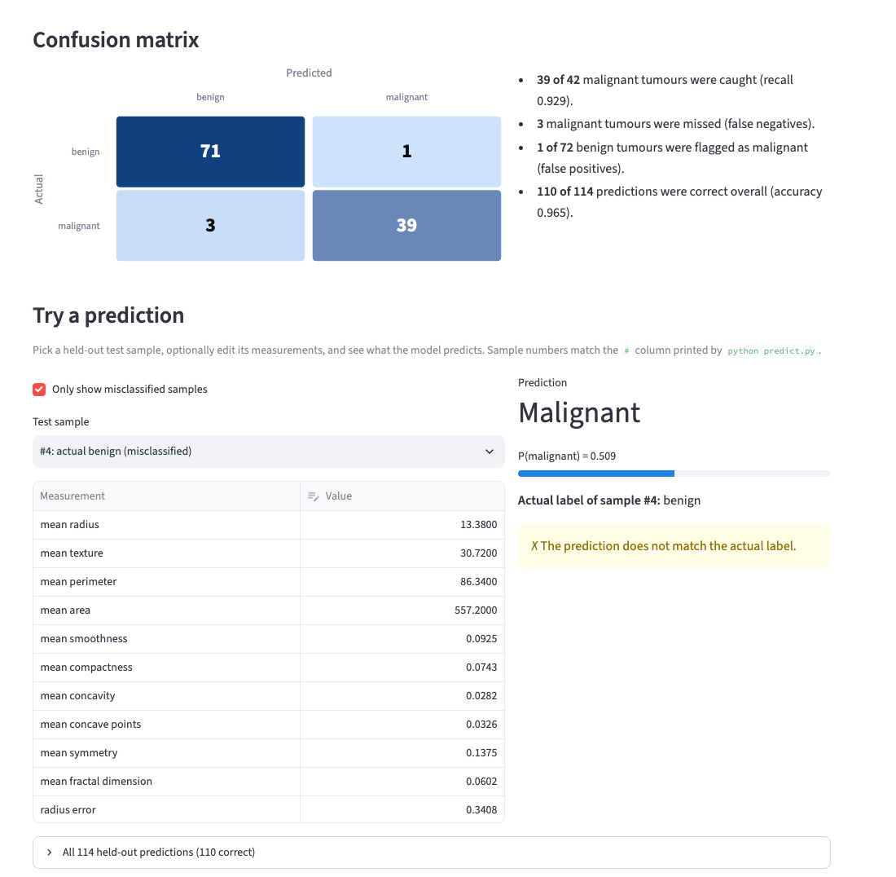

# Docker Lab 1: Breast Cancer Classifier in a Container

This lab is based on [Docker Lab 1](https://github.com/raminmohammadi/MLOps/tree/main/Labs/Docker_Labs/Lab1) from the MLOps course repo. The original lab packages a script that trains a Random Forest on the Iris dataset into a Docker image. This version keeps that core idea: a training job that runs in a container. It also changes the dataset and the model, and adds:

- a **Streamlit dashboard**
- a **Docker Compose** pipeline: tests, then training, then the dashboard
- a **healthcheck**
- automated **pytest** tests

The whole pipeline runs with one command:

```bash
docker compose up --build
```



## What I changed

| | Original lab | This version |
|---|---|---|
| Dataset | Iris (150 samples, 4 features, 3 classes) | Breast Cancer Wisconsin (569 samples, 30 features, benign vs. malignant) |
| Model | A fixed `RandomForestClassifier` | Four candidates (logistic regression, random forest, gradient boosting, SVM) compared with 5-fold stratified cross-validation on accuracy, F1 and ROC-AUC. The best one by ROC-AUC is kept. Each model is a `Pipeline` with a `StandardScaler`. |
| Evaluation | None, just prints "successful" | Accuracy, precision, recall, F1, ROC-AUC and a confusion matrix on a held-out test set, with malignant as the positive class |
| Output | `iris_model.pkl` saved inside the container, lost when it exits | `model.joblib` and `metrics.json` written to `/app/output`, which is a volume |
| Configuration | Hard-coded | Environment variables (`MODEL_TYPE`, `TEST_SIZE`, `RANDOM_STATE`, `CV_FOLDS`) |
| Inference | None | `predict.py` (command line) and an interactive dashboard |
| Dashboard | None | Streamlit app showing the metrics, model comparison, confusion matrix and live predictions |
| Orchestration | One `docker run` | `docker-compose.yml` with three services. Each one starts only after the previous one exits successfully. |
| Health monitoring | None | A `HEALTHCHECK` that marks the dashboard healthy only when the model is in the volume and the web server responds |
| Tests | None | 17 pytest tests for training, prediction, the dashboard and the healthcheck, run as the first Compose service |
| Dockerfile | Single stage, `python:3.10` (image builds to 2.06 GB), unpinned packages, runs as root | Multi-stage (`trainer`, `dashboard`, `tests`), `python:3.11-slim` (trainer image is 596 MB), pinned versions, cached dependency layer, non-root user, `.dockerignore` |

## Architecture



| Service | Image (Dockerfile target) | What it does | Starts after | Volume |
|---|---|---|---|---|
| `tests` | `breast-cancer-tests:v1` (`tests`) | Runs the pytest suite, then exits | — | none |
| `trainer` | `breast-cancer-trainer:v1` (`trainer`) | Trains, evaluates and saves the model, then exits | `tests` exited with code 0 | `model-artifacts` → `/app/output` (read-write) |
| `dashboard` | `breast-cancer-dashboard:v1` (`dashboard`) | Serves the Streamlit app on port 8501 | `trainer` exited with code 0 | `model-artifacts` → `/app/output` (**read-only**) |

How the Docker concepts fit together:

- **Multi-stage Dockerfile:** one `Dockerfile` builds three images.
  - A shared `base` stage installs the ML libraries and creates the non-root user.
  - `dashboard` adds Streamlit, `tests` adds pytest, and `trainer` adds only the code.
  - `trainer` is the last stage, so a plain `docker build .` still builds the original lab's training image.
- **Startup order:** each service uses `depends_on: condition: service_completed_successfully`. If the tests fail, training never runs. If training fails, the dashboard never starts.
- **Named volume:** the trainer writes the model to `model-artifacts`, and the dashboard reads the same files. The dashboard mounts the volume `:ro`, so it can't change the model.
- **Healthcheck:** `healthcheck.py` reports unhealthy if `model.joblib` or `metrics.json` is missing, or if Streamlit's `/_stcore/health` endpoint doesn't answer. It uses only the standard library, so each check is fast.
- **Port mapping:** `8501:8501` publishes the dashboard on your machine.
- **Environment variables:** variables from your shell, such as `MODEL_TYPE=svm docker compose up`, are passed through to the trainer.

## Project structure

```
Docker_Lab1/
├── Dockerfile                   # multi-stage: base -> dashboard -> tests, base -> trainer
├── docker-compose.yml           # tests -> trainer -> dashboard, shared volume
├── .dockerignore
├── README.md
├── assets/                      # dashboard screenshots used in this README
├── src/
│   ├── main.py                  # training job (default command of the trainer image)
│   ├── artifacts.py             # loads the model/report and rebuilds the test split (shared)
│   ├── predict.py               # command-line predictions with the saved model
│   ├── dashboard.py             # Streamlit dashboard
│   ├── healthcheck.py           # Docker HEALTHCHECK for the dashboard
│   ├── requirements.txt         # pinned training dependencies
│   └── requirements-dashboard.txt
└── tests/
    ├── conftest.py              # trains one model per test session
    ├── test_training.py         # data, config validation, training, predict.py
    ├── test_dashboard.py        # renders the dashboard headlessly with streamlit.testing
    ├── test_healthcheck.py      # healthy/unhealthy exit codes
    └── requirements.txt
```

`predict.py` and `dashboard.py` both load the model through `artifacts.py`. They rebuild the held-out test set from the split settings saved in `metrics.json`, so sample `#4` in `predict.py` is the same sample `#4` in the dashboard.

## Running the lab

You need [Docker Desktop](https://www.docker.com/products/docker-desktop/) with Compose v2. Run all commands from the `Docker_Lab1/` folder.

### 1. Start everything

```bash
docker compose up --build
```

Compose builds the three images, then runs the services in order (output shortened):

```
tests-1      | tests/test_dashboard.py::test_dashboard_shows_metrics_and_sections PASSED [  5%]
tests-1      | ...
tests-1      | tests/test_training.py::test_predict_script_without_model PASSED         [100%]
tests-1      | ============================== 17 passed in 2.59s ==============================
tests-1 exited with code 0
trainer-1    | Dataset: 569 samples, 30 features (455 train / 114 test)
trainer-1    | Cross-validating 4 model(s) with 5 folds (selecting by roc_auc):
trainer-1    |   model                 accuracy        f1   roc_auc
trainer-1    |   logistic_regression     0.9736    0.9640    0.9958
trainer-1    |   random_forest           0.9626    0.9489    0.9889
trainer-1    |   gradient_boosting       0.9670    0.9553    0.9908
trainer-1    |   svm                     0.9758    0.9670    0.9949
trainer-1    | Selected model: logistic_regression
trainer-1    | Test metrics (positive class = malignant):
trainer-1    |   accuracy   0.9649
trainer-1    |   precision  0.9750
trainer-1    |   recall     0.9286
trainer-1    |   f1         0.9512
trainer-1    |   roc_auc    0.9960
trainer-1    | Confusion matrix [benign, malignant]: [[71, 1], [3, 39]]
trainer-1    | Saved model.joblib and metrics.json to /app/output
trainer-1    | The model training was successful
trainer-1 exited with code 0
dashboard-1  |   You can now view your Streamlit app in your browser.
dashboard-1  |   URL: http://localhost:8501
```

Open **http://localhost:8501**. Press `Ctrl+C` to stop.

### 2. Check status and health

In a second terminal:

```bash
docker compose ps -a
```

```
SERVICE     STATUS                     PORTS
dashboard   Up 5 seconds (healthy)     0.0.0.0:8501->8501/tcp, [::]:8501->8501/tcp
tests       Exited (0) 8 seconds ago
trainer     Exited (0) 5 seconds ago
```

To see the files the trainer left in the shared volume:

```bash
docker compose exec dashboard ls -l /app/output
```

### 3. Change the training settings

The trainer reads its settings from your shell, so you don't need to edit any files:

```bash
MODEL_TYPE=svm docker compose up --build
```

| Variable | Default | Allowed values |
|---|---|---|
| `MODEL_TYPE` | `auto` | `auto`, `logistic_regression`, `random_forest`, `gradient_boosting`, `svm` |
| `TEST_SIZE` | `0.2` | Between 0 and 1 |
| `RANDOM_STATE` | `42` | Any integer |
| `CV_FOLDS` | `5` | An integer of 2 or more |

### 4. Other useful commands

| Command | What it does |
|---|---|
| `docker compose up --build -d --wait` | Runs in the background and returns once the dashboard is healthy |
| `docker compose run --rm tests` | Runs only the test suite |
| `docker compose logs trainer` | Shows the training output again |
| `docker compose down` | Stops and removes the containers, keeping the trained model in the volume |
| `docker compose down -v` | Also deletes the `model-artifacts` volume |

## Dashboard

The dashboard has five sections:

1. **Held-out test set:** accuracy, precision, recall, F1 and ROC-AUC of the selected model.
2. **Model comparison:** cross-validation accuracy, F1 and ROC-AUC for all four candidates. Dots show the mean, lines span ±1 standard deviation, and the selected model is drawn in blue. A table below lists the exact numbers.
3. **Confusion matrix:** test-set counts, with a plain-English summary of what was caught and what was missed.
4. **Try a prediction:**
   - Pick any held-out sample, optionally only the misclassified ones.
   - Edit any of its 30 measurements in the table.
   - The prediction and P(malignant) update immediately.
5. **All held-out predictions:** an expandable table of all 114 test samples.

The sidebar shows the training run (model, time, container ID, versions) and the settings it used.



The screenshot above shows sample #4 with the misclassified filter on. It's the one benign tumour the model flagged as malignant, with P(malignant) = 0.509, just over the line. `python predict.py` flags the same sample in the terminal.

## Results

Cross-validation on the 455 training samples (5 folds, mean ± std):

| Model | Accuracy | F1 | ROC-AUC |
|---|---|---|---|
| **logistic_regression** (selected) | 0.9736 ± 0.0149 | 0.9640 ± 0.0207 | **0.9958 ± 0.0047** |
| random_forest | 0.9626 ± 0.0149 | 0.9489 ± 0.0210 | 0.9889 ± 0.0070 |
| gradient_boosting | 0.9670 ± 0.0139 | 0.9553 ± 0.0196 | 0.9908 ± 0.0054 |
| svm | 0.9758 ± 0.0082 | 0.9670 ± 0.0120 | 0.9949 ± 0.0050 |

Selected model on the 114 held-out test samples:

| Accuracy | Precision | Recall | F1 | ROC-AUC |
|---|---|---|---|---|
| 0.965 | 0.975 | 0.929 | 0.951 | 0.996 |

- **Overall:** 110 of 114 test samples were classified correctly.
- **Errors:** 3 malignant tumours were missed, and 1 benign tumour was flagged as malignant.
- **Model choice:** the SVM scored slightly higher on cross-validation accuracy and F1. Logistic regression was kept because selection uses ROC-AUC. The gaps between the top models are smaller than one standard deviation, so in practice they perform about the same.

## Tests and failure handling

The `tests` service runs 17 tests before anything is trained:

| File | What it checks |
|---|---|
| `test_training.py` | Dataset shape and label encoding, stratified split, config defaults, rejecting invalid `MODEL_TYPE` / `TEST_SIZE` / `CV_FOLDS`, that training writes both files and keeps the best model, that the saved model reproduces the reported accuracy, and `predict.py` with and without a model |
| `test_dashboard.py` | Uses `streamlit.testing` to render the dashboard headlessly. It checks that the metrics match `metrics.json`, the prediction matches the model, the misclassified filter works, and a missing model shows an error instead of crashing. |
| `test_healthcheck.py` | Exit code 1 when the files are missing or the server is down, and exit code 0 when both are fine |

I also checked the failure paths by hand:

| Scenario | Result |
|---|---|
| A test fails | `service "tests" didn't complete successfully: exit 1`. The trainer and dashboard stay in `Created` and never start. |
| Training fails (`MODEL_TYPE=xgboost docker compose up`) | `service "trainer" didn't complete successfully: exit 1`. The dashboard never starts. |
| Dashboard started without a model | Docker marks it `unhealthy`, and the healthcheck log says `missing model.joblib, metrics.json in /app/output` |
| Dashboard writes to the volume | Refused: `Read-only file system` |

## Running without Compose (the original lab's steps)

The original single-container workflow still works, because `trainer` is the Dockerfile's default target:

```bash
docker build -t breast-cancer-trainer:v1 .
```

```bash
docker run --rm -v "$(pwd)/output:/app/output" breast-cancer-trainer:v1
```

```bash
docker run --rm -v "$(pwd)/output:/app/output" breast-cancer-trainer:v1 python predict.py -n 8
```

```
  #  actual     predicted  P(malignant)
  0  benign     benign            0.000
  1  malignant  malignant         1.000
  2  benign     benign            0.043
  3  malignant  malignant         0.576
  4  benign     malignant         0.509  <- wrong
  5  benign     benign            0.001
  6  malignant  malignant         0.762
  7  benign     benign            0.001

7/8 correct
```

Settings can be changed with `-e`, for example `docker run --rm -e MODEL_TYPE=random_forest -e TEST_SIZE=0.3 -v "$(pwd)/output-rf:/app/output" breast-cancer-trainer:v1`. To share the image as a file, as in the original lab:

```bash
docker save breast-cancer-trainer:v1 > breast-cancer-trainer_v1.tar
```

```bash
docker load < breast-cancer-trainer_v1.tar
```

## Notes

- **Port in use:** if something else uses port 8501, change the left side of the mapping in `docker-compose.yml`, for example `"8502:8501"`.
- **Linux hosts:** the containers run as user ID 1000. With the named volume this just works. For the `docker run -v "$(pwd)/output..."` commands, add `--user "$(id -u):$(id -g)"` if the container can't write to `output/`.
- **Windows PowerShell:** use `${PWD}/output` instead of `$(pwd)/output`. To set a variable for Compose, run `$env:MODEL_TYPE="svm"; docker compose up --build`.
- **Privacy:** the dashboard sends no usage statistics, and Streamlit's public-IP lookup and "Deploy" button are turned off.
