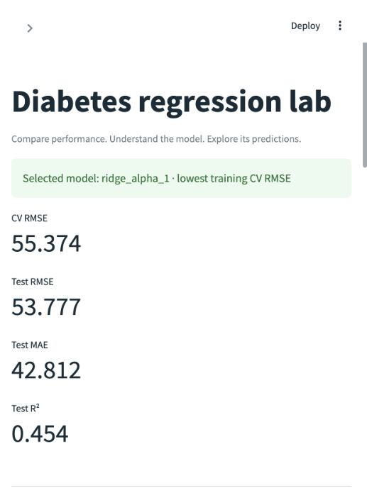
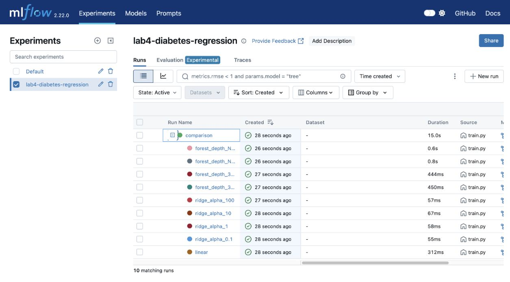
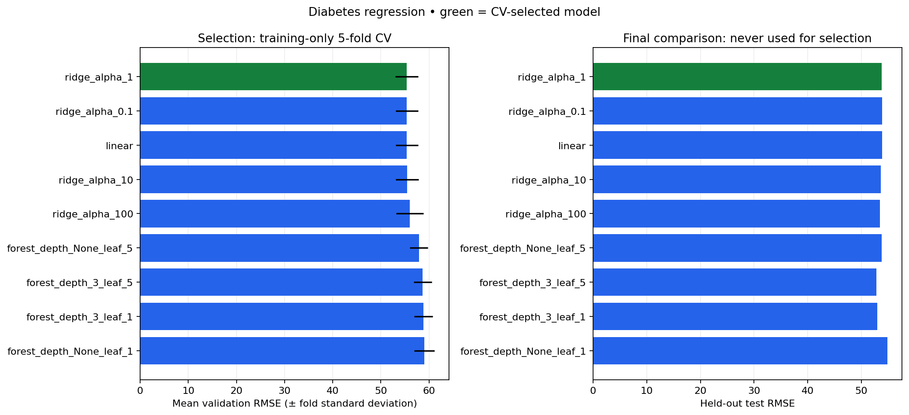
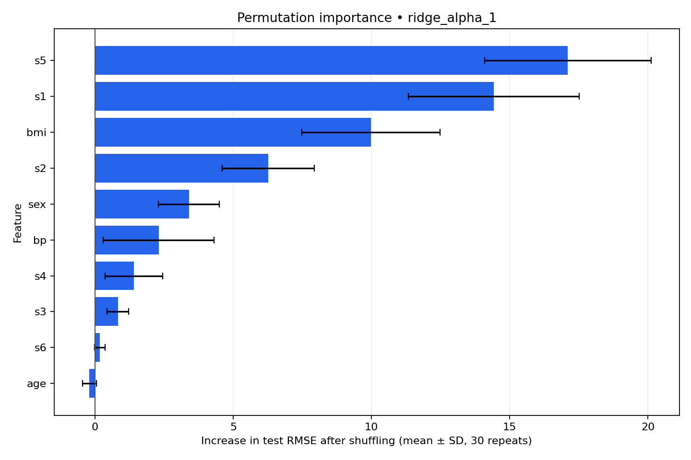
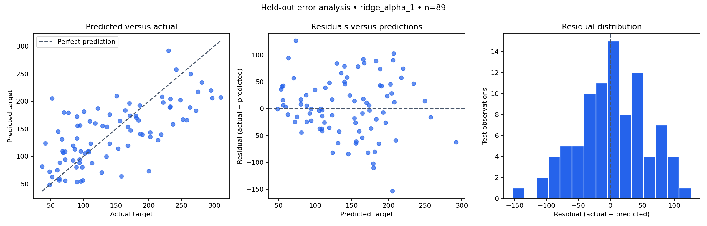

# Assignment 4 — Reproducible MLflow Experiment Tracking

This lab compares Linear Regression, Ridge, and Random Forest on the Diabetes dataset. MLflow records the experiments, and a Streamlit dashboard displays the results and runs predictions with the saved model.

## Acknowledgment and original lab

Based on [MLflow Lab 1 by Ramin Mohammadi and contributors](https://github.com/raminmohammadi/MLOps/tree/main/Labs/Experiment_Tracking_Labs/Mlflow_Labs/Lab1) and the [guide by Sai Akhilesh Ande](https://www.mlwithramin.com/blog/mlflow-lab1).

The original `linear_regression.py` trains ElasticNet on downloaded Wine Quality data, accepts alpha/l1_ratio arguments, logs regression metrics and a model. `starter.ipynb` demonstrates autologging, Random Forest on Diabetes, and saving/loading. `serving.py` demonstrates model dependency artifacts using XGBoost and Iris.

### Meaningful modifications

- Replaced Wine Quality/ElasticNet in the regression script with Diabetes and three model families: LinearRegression, Ridge, RandomForestRegressor. The starter notebook also uses Diabetes; here it replaces Wine Quality in the regression example.
- Compared nine configurations: one Linear Regression, Ridge alpha 0.1/1/10/100, and Random Forest depth 3/unlimited × minimum leaf size 1/5 (150 trees).
- Fixed the split, CV shuffle, and Random Forest seeds at 42.
- Loaded raw features (`scaled=False`), with StandardScaler fitted inside each training fold through a Pipeline, instead of relying on full-dataset scaling.
- Used five-fold training-only CV for selection, then reported held-out test metrics.
- Added named parent/child MLflow runs, model-type and selection tags, explicit parameters, CV metrics, test MAE/RMSE/R², signatures, input examples, and model artifacts.
- Exported a comparison CSV/chart, a selected-model summary, a local MLflow-format pipeline, and JSON example input. Verified that predictions matched after reloading.
- Added reusable functions, command-line training/prediction, automated tests, pinned dependencies, and a shared SQLite tracking configuration.
- Added a Streamlit dashboard with model/metric filters, explainability and error views, CSV downloads, and interactive saved-model prediction.
- Added held-out permutation feature importance (30 repeats), predicted-versus-actual and residual plots, and per-observation prediction errors; logged these as MLflow artifacts.

## Dataset and methodology

Scikit-learn's bundled [Diabetes regression dataset](https://scikit-learn.org/stable/modules/generated/sklearn.datasets.load_diabetes.html) has 442 observations and ten baseline features: age, sex, BMI, blood pressure, and six serum measurements. The target is a quantitative measure of disease progression one year after baseline. This is a regression exercise, not a diabetes diagnosis tool. No dataset download is needed.

The 80/20 split gives 353 training rows and 89 test rows. All candidates use the same five shuffled training folds. The model with the lowest mean validation RMSE is selected before evaluating the test set. The saved model is trained on the 353 training rows only. CV error bars show the standard deviation across folds, not confidence intervals.

## Setup

Use Python 3.11. From the repository root:

```bash
cd MLflow_Lab1
python3.11 -m venv .venv
source .venv/bin/activate
python -m pip install -r requirements-lock.txt
```

`requirements.txt` pins the direct dependencies; `requirements-lock.txt` records the complete tested environment. The tested MLflow version is 2.22.0.

## Run

From `MLflow_Lab1`, with the environment active:

```bash
python train.py
python predict.py
python predict.py --input outputs/example_input.json
python -m pytest -q
mlflow ui --backend-store-uri sqlite:///mlflow.db --host 127.0.0.1 --port 5001
```

Open http://127.0.0.1:5001 and choose `lab4-diabetes-regression`. Expand the `comparison` parent run to see nine candidates. Compare `cv_rmse`, `test_rmse`, `test_mae`, and `test_r2`; inspect each run's `model` artifact and the parent's `comparison` artifacts. Stop the UI with Ctrl-C.

Training and the UI use the same `mlflow.db` when the UI command is run **from `MLflow_Lab1`**. Artifacts are stored in `mlartifacts/` using absolute local paths.

Each training run creates one parent and nine child runs, saves the model under `models/<parent_run_id>/`, and updates `outputs/`. Prediction uses `outputs/best_model.json` to locate the model. **After cloning or moving the project, run `python train.py` before making predictions.** Models and the tracking database are excluded from Git.

Custom inference input is a JSON list of records with exactly the ten raw feature names listed above. The saved pipeline performs scaling. `outputs/example_input.json` is a real held-out example. The prediction script checks for missing models and invalid input.

## Interactive dashboard

After setup, launch the dashboard from `MLflow_Lab1`:

```bash
streamlit run dashboard.py --server.address 127.0.0.1 --server.port 8501
```

Open [the local dashboard](http://127.0.0.1:8501). Use the sidebar's **Explore** selector to switch views; in a narrow window, open the sidebar with the arrow at the top left. Stop the server with Ctrl-C.

- **Model comparison:** filter model families, select CV RMSE/test RMSE/test MAE/test R², inspect the sortable table, and download the filtered CSV. The green bar identifies the CV-selected model even when sorting by test metrics.
- **Feature importance:** explore the interactive permutation-importance chart with standard-deviation lines, hover values, and CSV export.
- **Error analysis:** inspect the three diagnostic plots, filter observations by absolute error, and download the filtered errors.
- **Prediction:** start from the held-out example or dataset medians, edit all ten raw features, and run the saved pipeline. Observed feature ranges appear in help text. Invalid sex codes/non-finite inputs are rejected; values outside observed ranges show an extrapolation warning.

The dashboard reads `outputs/` and the saved model. Click **Refresh results** after training. Committed charts and comparisons can be viewed without a local model; the prediction page shows setup instructions if the model is missing.

The dashboard runs locally on port 8501, separately from the MLflow UI on port 5001. Streamlit usage statistics are disabled.

The dashboard was tested in the browser, including the prediction form. Automated tests cover filters, prediction agreement, invalid input, and missing files.



## Files

- `train.py`, `predict.py`: command-line entry points.
- `dashboard.py`, `src/dashboard.py`, `.streamlit/config.toml`: interactive local dashboard.
- `tests/test_dashboard.py`: dashboard filters, prediction validation, and missing-artifact handling.
- `src/experiment.py`: data loading, preprocessing, selection, tracking, visualization, and inference.
- `tests/test_experiment.py`: data, metrics, reproducibility, leakage checks, selection, tracking, and prediction tests.
- `outputs/`: small, committed measured results and chart.
- `models/`, `mlartifacts/`, `mlflow.db`, `.venv/`: local generated state, excluded from Git.

## Results

Measured locally on November 12, 2026 with Python 3.11.18. Nine configurations produced ten finished MLflow runs (one parent and nine children).

| Candidate | CV RMSE | Test MAE | Test RMSE | Test R² |
|---|---:|---:|---:|---:|
| ridge_alpha_1 **selected** | 55.3742 | 42.8120 | 53.7775 | 0.4541 |
| ridge_alpha_0.1 | 55.3889 | 42.7962 | 53.8429 | 0.4528 |
| linear | 55.3946 | 42.7941 | 53.8534 | 0.4526 |
| ridge_alpha_10 | 55.4351 | 42.8568 | 53.6263 | 0.4572 |
| ridge_alpha_100 | 56.0013 | 43.2507 | 53.4624 | 0.4605 |
| forest_depth_None_leaf_5 | 57.8731 | 43.6638 | 53.7600 | 0.4545 |
| forest_depth_3_leaf_5 | 58.6645 | 42.7630 | 52.8121 | 0.4736 |
| forest_depth_3_leaf_1 | 58.8498 | 42.8978 | 52.9226 | 0.4714 |
| forest_depth_None_leaf_1 | 59.0130 | 44.5039 | 54.8199 | 0.4328 |

Selected: **Ridge, alpha=1**, using lowest CV RMSE (55.3742). Random Forest depth=3/leaf=5 had a lower test RMSE (52.8121), but Ridge was selected using CV and remains the saved model.

Reloaded example prediction: **139.862774**; actual example target: **219**. This single prediction illustrates inference, not overall accuracy.

Validation: **15 tests passed** (19 upstream dependency deprecation warnings). Training, model reloading, both prediction commands, and the MLflow UI were checked successfully.

### Actual MLflow screenshot

This screenshot shows the first successful execution. The latest run IDs are in `outputs/best_model.json`.





## Explainability and error analysis

Training also generates the following diagnostics for the selected model on the 89 test observations. They are used to understand its predictions, not to tune the model.

### Permutation feature importance

Scikit-learn's [permutation importance](https://scikit-learn.org/stable/modules/permutation_importance.html) shuffles each input feature 30 times with seed 42 and measures the change in test RMSE. The model is not retrained. Positive values mean shuffling worsens accuracy; negative values mean shuffling slightly improves it on this sample. Error bars show the standard deviation across permutations, not confidence intervals.

For the selected Ridge model, the largest mean RMSE increases were **s5: 17.106**, **s1: 14.425**, and **BMI: 9.986** target units. These values show how much this model relies on each input, not causal effects. Correlated serum measurements can affect the rankings, so low importance does not necessarily mean a feature is unhelpful.



### Prediction errors

The plots show predicted versus actual values with a perfect-prediction reference, residuals versus predicted values with a zero reference, and a residual histogram. Residual is **actual minus predicted**: positive means underprediction and negative means overprediction.

Mean residual is **3.946** target units, but some individual errors are much larger. The largest absolute error is **153.386**: dataset row 56 has actual target 52 and prediction 205.386. The next largest is row 77: actual 200 and prediction 73.592 (underprediction by 126.408).



Generated files:

- `outputs/permutation_importance.csv` and `.png`: all ten feature importances, permutation standard deviations, and repeat count.
- `outputs/prediction_errors.csv`: original dataset row index, actual value, prediction, signed residual, and absolute error for all 89 test rows.
- `outputs/error_analysis.png`: the three error-analysis panels.

These files are also saved under `comparison/` in the parent MLflow run. Tests check permutation reproducibility, unchanged input data, residual calculations, and generated files.

## Limitations and conclusion

Results are based on a small dataset and one train/test split, so they may differ with another split or population. Fairness, clinical usefulness, and changes in data over time were not evaluated.

This lab demonstrates experiment tracking, model comparison, and loading a saved model for predictions. It runs locally with SQLite and requires no cloud services.

### Dependency compatibility

SQLAlchemy 2.0.41 is pinned because MLflow 2.22 imports a pool class removed in SQLAlchemy 2.1. Use the lock file to install the tested dependency versions.
