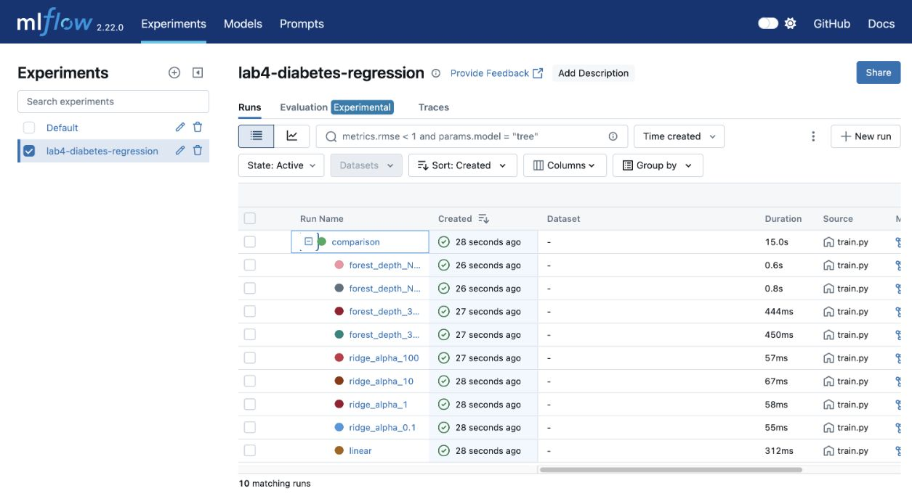
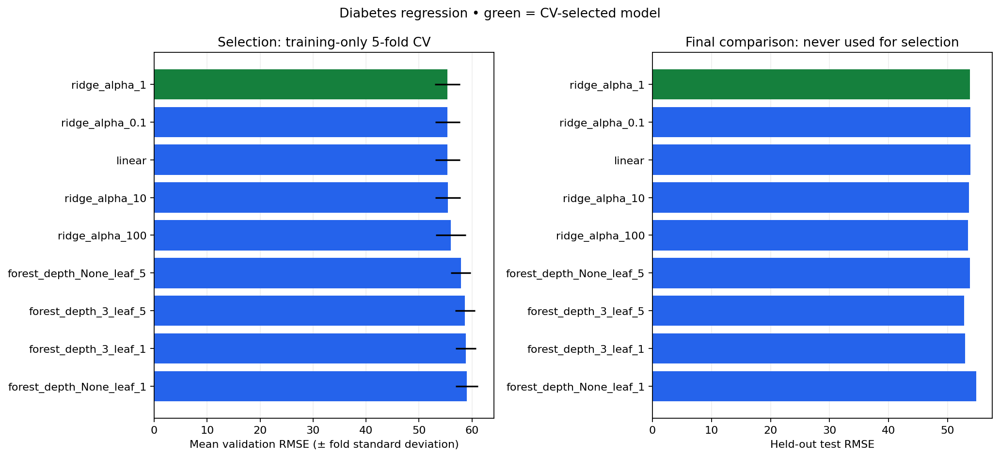
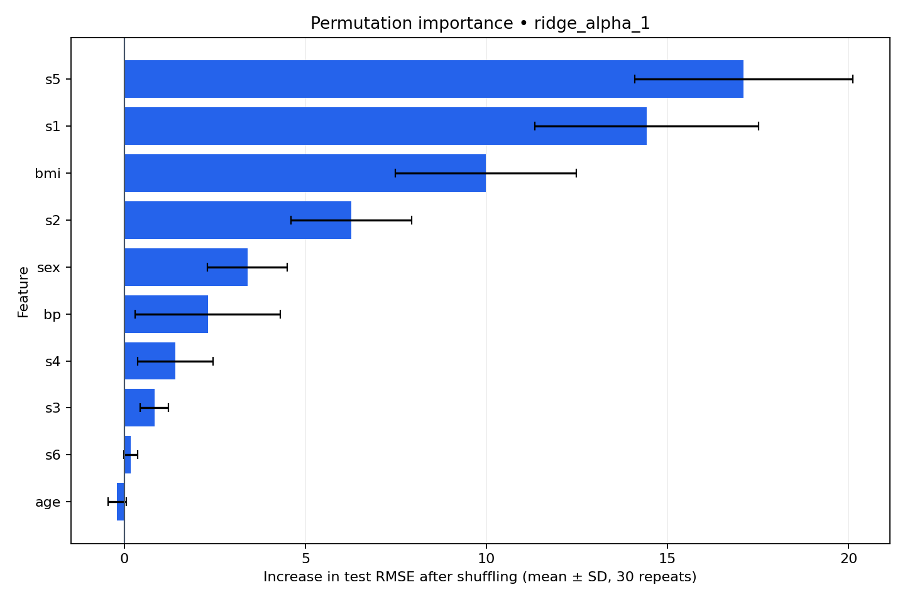
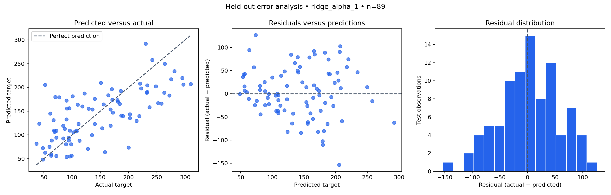

# Assignment 4 — Reproducible MLflow Experiment Tracking

Compare three regression model families, track their experiments with MLflow, and reload a selected pipeline for inference. This lab focuses on experiment tracking and reproducible model selection.

## Acknowledgment and original lab

Based on [MLflow Lab 1 by Ramin Mohammadi and contributors](https://github.com/raminmohammadi/MLOps/tree/main/Labs/Experiment_Tracking_Labs/Mlflow_Labs/Lab1) and the [guide by Sai Akhilesh Ande](https://www.mlwithramin.com/blog/mlflow-lab1).

The original `linear_regression.py` trains ElasticNet on downloaded Wine Quality data, accepts alpha/l1_ratio arguments, logs regression metrics and a model. `starter.ipynb` demonstrates autologging, Random Forest on Diabetes, and saving/loading. `serving.py` demonstrates model dependency artifacts using XGBoost and Iris. This project is an independently implemented extension of those tracking concepts.

### Meaningful modifications

- Replaced Wine Quality/ElasticNet in the regression script with Diabetes and three model families: LinearRegression, Ridge, RandomForestRegressor. **Diabetes is already used in the original starter notebook; it is not claimed as a dataset new to the entire lab.**
- Compared nine configurations: one Linear Regression, Ridge alpha 0.1/1/10/100, and Random Forest depth 3/unlimited × minimum leaf size 1/5 (150 trees).
- Fixed the split, CV shuffle, and Random Forest seeds at 42.
- Loaded raw features (`scaled=False`), with StandardScaler fitted inside each training fold through a Pipeline, instead of relying on full-dataset scaling.
- Used five-fold training-only CV for selection, then reported held-out test metrics. The test set never chooses hyperparameters or the winner.
- Added named parent/child MLflow runs, model-type and selection tags, explicit parameters, CV metrics, test MAE/RMSE/R², signatures, input examples, and model artifacts.
- Exported a comparison CSV/chart, a selected-model summary, a local MLflow-format pipeline, and JSON example input. Verified that predictions matched after reloading.
- Added reusable functions, command-line training/prediction, automated tests, pinned dependencies, and a shared SQLite tracking configuration.
- Added held-out permutation feature importance (30 repeats), predicted-versus-actual and residual plots, and per-observation prediction errors; logged these as MLflow artifacts.

## Dataset and methodology

Scikit-learn's bundled [Diabetes regression dataset](https://scikit-learn.org/stable/modules/generated/sklearn.datasets.load_diabetes.html) has 442 observations and ten baseline features: age, sex, BMI, blood pressure, and six serum measurements. The target is a quantitative measure of disease progression one year after baseline. This is a regression exercise, not a diabetes diagnosis tool. No dataset download is needed.

An 80/20 split yields 353 training rows and 89 test rows. Every candidate uses the same five shuffled training folds. Lowest mean validation RMSE selects the winner; fold standard deviation is reported for context, not as a confidence interval. All candidates are then fitted on the training partition and evaluated on the untouched test partition for a final descriptive comparison. A lower test RMSE for another candidate would not change the selected model. The exported model remains trained only on the 353 training rows, preserving the meaning of the reported test results.

## Setup

Use Python 3.11. From the repository root:

```bash
cd MLflow_Lab1
python3.11 -m venv .venv
source .venv/bin/activate
python -m pip install -r requirements-lock.txt
```

`requirements.txt` pins the direct dependencies; `requirements-lock.txt` records the complete tested environment. MLflow 2.22.0 is deliberately pinned so the tracking and model APIs stay consistent.

## Run

From `MLflow_Lab1`, with the environment active:

```bash
python train.py
python predict.py
python predict.py --input outputs/example_input.json
python -m pytest -q
mlflow ui --backend-store-uri sqlite:///mlflow.db --host 127.0.0.1 --port 5001
```

Open http://127.0.0.1:5001 and choose `lab4-diabetes-regression`. Expand the `comparison` parent run to see nine candidates. Compare `cv_rmse`, `test_rmse`, `test_mae`, and `test_r2`; inspect each run's `model` artifact and the parent's `comparison` artifacts. Stop the UI with Ctrl-C.

Training resolves `mlflow.db` relative to the lab's source directory; the UI command above uses that same database when run **from this directory**. MLflow stores artifacts in `mlartifacts/` with absolute local artifact locations. If you move the project to another machine, rerun training to create that machine's database and models.

Each training invocation creates a new parent plus nine child runs and a uniquely named local model under `models/<parent_run_id>/`. The files in `outputs/` are refreshed to describe the latest completed execution. Prediction reads `outputs/best_model.json`; on a fresh clone, run training first because generated models are intentionally excluded from Git.

Custom inference input is a JSON list of records with exactly the ten raw feature names listed above. The saved pipeline performs scaling. `outputs/example_input.json` is a real held-out example. Missing models, missing/extra columns, empty input, and non-finite values produce actionable errors.

## Files

- `train.py`, `predict.py`: command-line entry points.
- `src/experiment.py`: data loading, preprocessing, selection, tracking, visualization, and inference.
- `tests/test_experiment.py`: data, metrics, reproducibility, leakage checks, selection, tracking, and prediction tests.
- `outputs/`: small, committed measured results and chart.
- `models/`, `mlartifacts/`, `mlflow.db`, `.venv/`: local generated state, excluded from Git.

## Results

Measured locally on November 12, 2026 with Python 3.11.18. Nine configurations produced ten finished MLflow runs (one parent and nine children).

| Candidate | CV RMSE | Test MAE | Test RMSE | Test R² |
|---|---:|---:|---:|---:|
| ridge_alpha_1 **selected** | 55.3742 | 42.8120 | 53.7775 | 0.4541 |
| ridge_alpha_0.1 | 55.3889 | 42.7962 | 53.8429 | 0.4528 |
| linear | 55.3946 | 42.7941 | 53.8534 | 0.4526 |
| ridge_alpha_10 | 55.4351 | 42.8568 | 53.6263 | 0.4572 |
| ridge_alpha_100 | 56.0013 | 43.2507 | 53.4624 | 0.4605 |
| forest_depth_None_leaf_5 | 57.8731 | 43.6638 | 53.7600 | 0.4545 |
| forest_depth_3_leaf_5 | 58.6645 | 42.7630 | 52.8121 | 0.4736 |
| forest_depth_3_leaf_1 | 58.8498 | 42.8978 | 52.9226 | 0.4714 |
| forest_depth_None_leaf_1 | 59.0130 | 44.5039 | 54.8199 | 0.4328 |

Selected: **Ridge, alpha=1**, using lowest CV RMSE (55.3742). Random Forest depth=3/leaf=5 happened to have the lowest test RMSE (52.8121), but changing the winner after seeing that would use the test set for selection. Ridge remains the exported model.

Reloaded example prediction: **139.862774**; actual example target: **219**. This single prediction illustrates inference, not overall accuracy.

Validation: **12 tests passed** (18 upstream Pydantic/Matplotlib dependency deprecation warnings). Training, saved-model round trip, both prediction commands, and the local MLflow UI were exercised successfully.

### Actual MLflow screenshot

Captured from the original successful training execution; its ten runs are visible. Subsequent executions add another parent and nine children. The latest run IDs are recorded in `outputs/best_model.json`.





## Explainability and error analysis

Every `python train.py` execution produces these post-selection diagnostics for the CV-selected pipeline on the 89 held-out observations. They are descriptive only: they do not select features, tune parameters, or change the winner.

### Permutation feature importance

Using scikit-learn's [permutation importance](https://scikit-learn.org/stable/modules/permutation_importance.html), shuffle each raw input feature 30 times with seed 42 and measure the increase in RMSE relative to the unshuffled test predictions. The complete fitted pipeline remains fixed. Positive values mean shuffling worsens accuracy; negative values mean shuffling slightly improves it on this sample. Error bars show the standard deviation across permutations, not confidence intervals.

For the selected Ridge model, the largest mean RMSE increases were **s5: 17.106**, **s1: 14.425**, and **BMI: 9.986** target units. These describe the model's reliance on inputs, not causal effects. Correlated serum measurements can distort individual rankings; a low importance does not establish that a feature is intrinsically irrelevant.



### Prediction errors

The plots show predicted versus actual values with a perfect-prediction reference, residuals versus predicted values with a zero reference, and a residual histogram. Residual is **actual minus predicted**: positive means underprediction and negative means overprediction.

Mean residual is **3.946** target units, but this small average hides substantial individual errors. The largest absolute error is **153.386**: dataset row 56 has actual target 52 and prediction 205.386. The next largest is row 77: actual 200 and prediction 73.592 (underprediction by 126.408). These cases demonstrate why aggregate metrics alone are insufficient.



Generated files:

- `outputs/permutation_importance.csv` and `.png`: all ten feature importances, permutation standard deviations, and repeat count.
- `outputs/prediction_errors.csv`: original dataset row index, actual value, prediction, signed residual, and absolute error for all 89 test rows.
- `outputs/error_analysis.png`: the three error-analysis panels.

The latest parent MLflow run stores these files under `comparison/`, alongside the existing comparison outputs. Its parameters record the scoring rule, repeat count, and diagnostic partition. Tests check signal detection, deterministic permutations, unchanged input data, residual signs, row identity, and generated artifacts. No additional dependencies are needed.

## Limitations and conclusion

This small dataset and one fixed holdout cannot establish generalization to other populations. CV comparisons also have selection uncertainty; the standard-deviation bars are descriptive. The experiment does not evaluate fairness, clinical utility, or deployment drift. The contribution is a repeatable, inspectable experiment-to-inference workflow rather than a production clinical model.

No cloud services are required. The SQLite backend is intended for local coursework. The GitHub submission contains source and measured summaries; training regenerates the excluded model artifacts and database.

### Dependency compatibility

SQLAlchemy 2.0.41 is pinned because MLflow 2.22 imports a pool class removed in SQLAlchemy 2.1. The complete lock file prevents future dependency resolution from silently changing the tested environment.
